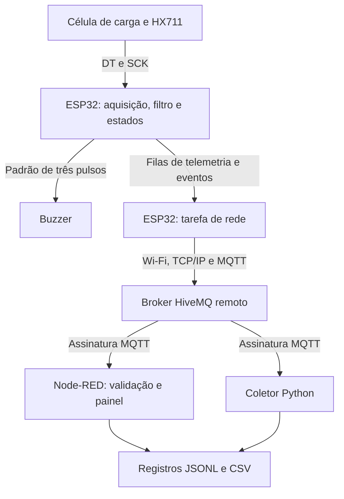
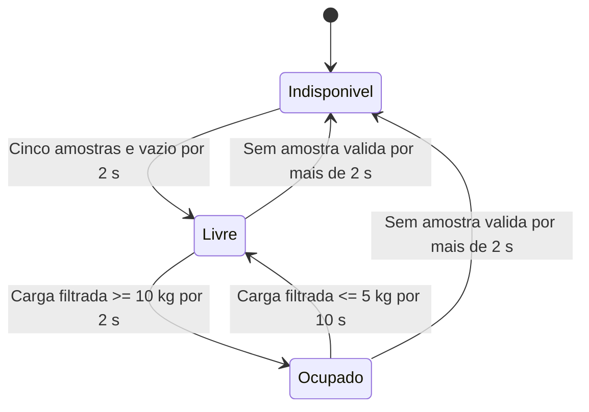

# Documentação do software e das interfaces internas

Este guia descreve o código publicado. A concepção física e sua adaptação para o Wokwi estão em [MONTAGEM.md](MONTAGEM.md); a reprodução está em [EXECUCAO.md](EXECUCAO.md).

## Arquitetura

A tarefa de rede executa no núcleo 0 do ESP32 especificado. O `loop()` executa aquisição, atualização dos estados e atuação local. A comunicação entre tarefas utiliza uma fila de telemetria de uma posição, que mantém a atualização mais recente, e uma fila de até 16 eventos. A rede pode bloquear temporariamente sua própria tarefa sem interromper deliberadamente o relógio e o buzzer do laço local.

## Arquivos e responsabilidades

| Arquivo | Responsabilidade |
|---|---|
| `ChairMonitor.ino` | Integra o HX711, a lógica, o buzzer, as filas e o cliente MQTT. |
| `Monitor.h` | Lógica C++ independente do Arduino: filtro, disponibilidade, ocupação, tempo e geração dos eventos. |
| `config.h` | GPIOs, Wi-Fi, broker, prefixo, fator de escala e intervalo de lembrete. |
| `diagram.json` | Componentes e conexões da reprodução virtual. |
| `libraries.txt` | Bibliotecas utilizadas pelo projeto no Wokwi. |
| `platformio.ini` | Plataforma, placa, dependências e perfis de compilação. |
| `node-red/process-message.js` | Valida mensagens, atualiza o contexto do receptor e produz saídas para painel e registro. |
| `node-red/dashboard.vue` | Indicadores, gráfico, lista de eventos e download CSV no painel. |
| `node-red/flows.json` | Fluxo importável com fonte de processamento e interface incorporadas. |
| `node-red/settings.js` | Porta e endereço local do editor Node-RED. |
| `scripts/collect_mqtt.py` | Assina o broker e registra mensagens recebidas, horário UTC e metadados. |
| `scripts/export_csv.py` | Converte JSONL em CSV e impede sobrescrever arquivo existente. |
| `scripts/build-flow.cjs` | Gera o fluxo a partir das fontes e sincroniza o diagrama da raiz. |
| `scripts/validate.cjs` | Verifica JSON, referências entre nós e sincronização do fluxo com a fonte. |

## Funções do firmware

| Função | Entrada / efeito / saída |
|---|---|
| `setup()` | Inicializa serial a 115200 baud, buzzer e HX711; cria filas e tarefa de rede. A tara é concluída progressivamente no laço. |
| `loop()` | Tenta obter uma amostra a cada 100 ms; faz a tara com dez leituras; chama a lógica; gera eventos e telemetria e atualiza o som. |
| `emitPacket(event, suffix, payload)` | Monta tópico e pacote, imprime no serial e envia à fila apropriada. Em fila de eventos cheia, registra descarte no serial. |
| `publishState(now)` | Serializa estado, ocupação, duração, alerta e uptime em JSON e atualiza a fila de telemetria. |
| `updateSound(now)` | Liga/desliga o tom nas fases de 200 ms sem espera longa; interrompe ao encerrar o ciclo ou entrar em indisponibilidade. |
| `networkTask(void*)` | Configura Wi-Fi e MQTT, tenta reconectar a cada 5 s, publica status, transmite a última telemetria e consome eventos voláteis. |
| `Monitor::step(now, hasSample, kg)` | Recebe relógio em ms e amostra opcional. Atualiza média de cinco leituras e estados; retorna `NONE`, `START`, `END` ou `REMINDER`. Chamadas sem amostra permitem verificar o tempo desde a última leitura. |
| `Monitor::state()` | Retorna `livre`, `ocupado` ou `indisponivel`. |
| `Monitor::elapsed(now)` | Retorna duração corrente em ms quando disponível e ocupado; caso contrário, zero. |
| `Monitor::endedDuration` | Preserva em ms a duração encerrada para compor o evento `fim`. |

## Máquina de estados

A inicialização inclui tara anterior ao rearmamento. O assento deve permanecer vazio nesse procedimento. Ao ocupar, emite-se `inicio`; ao confirmar saída, `fim`. O alerta é uma condição dentro do estado ocupado: emite `lembrete` ao atingir 60 s no perfil de teste ou 1.800 s no prolongado, repetindo a cada 60 s. Ausência menor que 10 s não encerra o ciclo. Na faixa intermediária, a histerese preserva a ocupação.

Na falha, a disponibilidade fica falsa, a ocupação publicada fica nula, o som é interrompido e a duração do ciclo anterior é incerta. A recuperação requer novamente leituras e assento vazio; a tara original não é substituída automaticamente por uma leitura com carga.

## Processamento no Node-RED

`processMessage(msg, context, now)` recebe tópico/payload, armazenamento de contexto e relógio do receptor. Usa `Date.now()` por padrão; os testes fornecem relógio controlado.

| Situação | Comportamento |
|---|---|
| Telemetria válida | Atualiza estado e horário de recebimento; mantém até 180 pontos no gráfico. |
| Evento válido | Acrescenta um evento com horário do receptor; mantém os últimos 200 no painel. |
| Status válido | Registra `online` ou `offline`. |
| Pulso interno `__tick` | Reavalia a indicação de dados desatualizados, sem fabricar mensagem do dispositivo. |
| Mensagem inválida | Retorna `null`; não atualiza o painel nem grava pelo fluxo. |
| Uptime menor que o anterior | Limpa o gráfico para refletir reinício ou volta do contador. |

O retorno possui duas saídas: a primeira alimenta o painel; a segunda contém a linha JSONL de uma mensagem recebida válida, ou `null` para o pulso interno. O registro em disco não depende do limite de eventos exibidos na interface.

## Interfaces, unidades e limites

| Interface | Configuração e conteúdo |
|---|---|
| HX711 ↔ ESP32 | DT no GPIO19 e SCK no GPIO18; leitura pela biblioteca HX711. O firmware não configura essa interface como I²C ou SPI. |
| ESP32 → buzzer | GPIO23; tom de 2 kHz e três pulsos de 200 ms com intervalos de 200 ms. |
| USB/serial | Alimentação e registro de depuração a 115200 baud. |
| ESP32 ↔ broker | Wi-Fi de 2,4 GHz, TCP/IP, MQTT 3.1.1, porta 1883. Contrato completo em [MQTT.md](MQTT.md). |
| Node-RED ↔ navegador | Interface local em `127.0.0.1:1880`; painel em `/dashboard/cadeira`. |
| Dados internos | Carga em kg, relógio e intervalos em ms. |
| Payload MQTT | Duração em segundos, `uptime_ms` em ms e estado textual. |
| Registro do receptor | Data UTC do recebimento; não substitui o relógio do dispositivo para avaliar temporização. |

MQTT com QoS 0 não garante entrega. O firmware não tem persistência nem reenvio histórico. O painel documenta o que recebeu, não prova que todas as mensagens emitidas chegaram. Os lembretes permanecem decididos localmente. A extensão instrumentada acrescenta o tópico de comando remoto de teste, descrito em TEMPOS_RESPOSTA.md.

## Alterações e verificações

Parâmetros funcionais são alterados em `config.h` ou por definições de compilação. Segredos e calibração física ficam no arquivo ignorado `local_config.h`. O fator virtual 420 não serve como calibração do sensor físico.

Após alterar processamento, interface ou diagrama, gere novamente `node scripts/build-flow.cjs`. Consulte [VALIDACAO.md](VALIDACAO.md) e os testes incluídos para distinguir lógica verificada, compilação e execução integrada documentada.

## Diagnóstico da leitura observado na execução

O firmware também mantém `diagnosticRaw`, a última amostra bruta, e imprime `SENSOR raw=... tara=... carga_filtrada_kg=...` quando publica o estado. Essa linha é de diagnóstico serial; não é enviada como tópico MQTT nem modifica o esquema de telemetria. Ela ajudou a identificar as conexões incorretas no diagrama.

Na sessão corrigida foram observados 8.400 → 20 kg e 3.780 → 9 kg, usando o fator virtual 420. A fonte publicada é a mesma baixada do Wokwi e identificada por hash em [RESULTADOS_WOKWI.md](RESULTADOS_WOKWI.md).

## Instrumentação de tempos de resposta

As funções de medição estão no próprio ChairMonitor.ino, preservado no ZIP baixado do Wokwi:

| Função | Papel |
|---|---|
| measureParseId() | Lê o identificador positivo do contrato de ensaio. |
| measureCallback() | Registra o instante de recepção; responde sondas ou enfileira comando reconhecido. |
| measureSubscribe() | Assina sondas e comandos após a conexão MQTT. |
| measureLocal() | Consome comandos no laço local e controla o padrão sonoro com tone()/noTone(). |
| measureWave() | Observa o GPIO23 a cada 50 µs apenas até o primeiro HIGH; registra ação e desliga o observador. |
| measureNetwork() | Publica as confirmações produzidas pelo observador na tarefa de rede. |
| measureSensor() | Emite trace com ID e tempo de confirmação de ocupação, sem fabricar amostra de carga. |
| measureBegin() | Cria filas e timer de observação, inicialmente inativo. |

A tarefa MQTT não controla diretamente o som: entrega uma ordem à fila local. A confirmação level=1 documenta a ação elétrica virtual. Não mede resposta acústica. O plano e os resultados de quatro medições por componente estão em [TEMPOS_RESPOSTA.md](TEMPOS_RESPOSTA.md).
